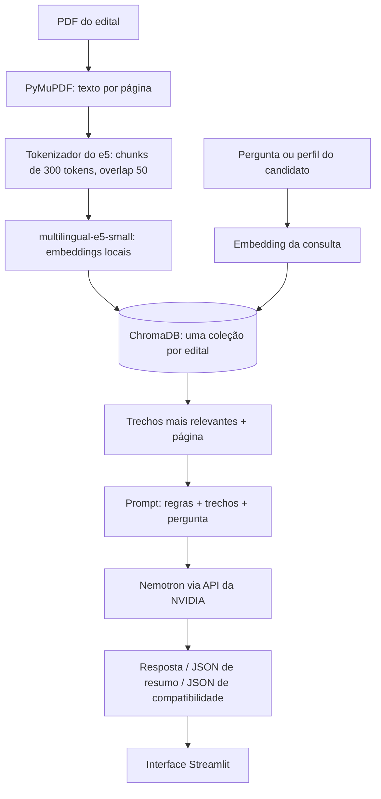

# 🎓 BolsaCheck

Aplicação web que usa **IA (LLM + RAG)** para ajudar candidatos a **mestrado e doutorado** a entender editais de pós-graduação e verificar se o seu perfil atende aos requisitos formais. Esse projeto aplica conceitos de tokenização, embeddings, Transformer, engenharia de prompt e RAG em um problema real

**O BolsaCheck não estima chances de aprovação nem de concessão de bolsa.** Ele só interpreta o edital e confere requisitos formais. Confirme sempre as informações no edital oficial.

## Equipe
- Matheus Tenório de Farias
- Luciano Gomes da silva

---

## Sumário

- [O problema](#o-problema)
- [Funcionalidades](#funcionalidades)
- [Como funciona (arquitetura)](#como-funciona-arquitetura)
- [Conteúdos da disciplina aplicados](#conteúdos-da-disciplina-aplicados)
- [Tecnologias](#tecnologias)
- [Estrutura do projeto](#estrutura-do-projeto)
- [Configuração (.env)](#configuração-env)
- [Limitações](#limitações)

---

## O problema

Editais de pós-graduação são longos (dezenas de páginas), têm regras diferentes para mestrado e doutorado, vários documentos, prazos e critérios espalhados pelo texto. É comum o candidato perder um prazo ou um documento por não ter lido tudo com atenção.

O BolsaCheck resume o edital, compara o perfil do candidato com os requisitos de elegibilidade e responde perguntas em linguagem natural, sempre indicando a página do edital de onde veio cada informação.

## Funcionalidades

1. **Base de editais**
   - Envio de PDFs pela interface, ou PDFs colocados na pasta `editais/`.
   - Extração do texto, divisão em chunks com a página de origem preservada e geração de embeddings.
   - Os vetores ficam salvos e são reaproveitados: o mesmo PDF nunca é indexado duas vezes.
2. **Resumo do edital** (Mestrado ou Doutorado)
   - Instituição, programa, modalidades e valor das bolsas, requisitos, documentação, prazos e critérios de seleção.
3. **Análise de compatibilidade**
   - Formulário de perfil: nível, graduação, titulação, idioma, vínculo, nacionalidade, dedicação exclusiva, ações afirmativas e **documentos que o candidato já possui**.
   - Cada requisito do edital recebe um status: ✅ atende, ❌ não atende, ⚠️ precisa de confirmação ou ➖ não se aplica, com justificativa e página.
   - Botão **"Comparar em TODOS os editais"**: o mesmo perfil analisado em cada edital da base, com tabela-resumo.
4. **Chat com os editais**
   - Perguntas em linguagem natural sobre o edital ativo ou sobre **todos os editais ao mesmo tempo**.
   - A resposta é gerada a partir dos trechos recuperados e mostra as fontes (edital e página) e os trechos usados.

## Como funciona (arquitetura)



**Indexação (uma vez por PDF):** o texto é extraído página a página, dividido em janelas medidas em **tokens** (não em caracteres), convertido em vetores e gravado no ChromaDB com a página como metadado. O identificador da coleção é derivado do hash do arquivo, então o mesmo PDF reaproveita os vetores já calculados.

**Consulta (a cada pergunta ou análise):** a pergunta vira um vetor, o ChromaDB devolve os trechos mais próximos (busca por similaridade de cosseno) e esses trechos entram no prompt do LLM, que responde **somente com base neles**.

## Conteúdos da disciplina aplicados

| Conteúdo | Onde está no projeto |
|---|---|
| **Tokenização** | `core/tokenizacao.py`: o chunking usa o tokenizer do modelo de embeddings (subpalavras), com janelas de 300 tokens e sobreposição de 50. Também há `tokenizar()` para visualizar os tokens. |
| **Embeddings** | `core/embeddings.py`: `multilingual-e5-small` roda localmente, com os prefixos `passage:` (documentos) e `query:` (perguntas) exigidos pelo modelo, e vetores normalizados. |
| **Transformer** | O e5 (encoder) transforma texto em vetores. O Nemotron (decoder) gera o texto das respostas. Os dois são modelos Transformer. |
| **Engenharia de prompt** | `core/rag.py` e `services/analisador_edital.py`: prompts de sistema separados para chat, chat multi-edital, resumo e compatibilidade, com regras explícitas, saída em JSON, exemplos e restrição de responder só com base no contexto. |
| **RAG** | `core/rag.py`: indexação no ChromaDB, busca semântica (em um ou em vários editais) e geração com os trechos como contexto. |

## Tecnologias

| Componente | Tecnologia |
|---|---|
| Linguagem | Python |
| Interface web | Streamlit |
| LLM | `nvidia/nemotron-3.5-lightning-30b-a3b`, pela API gratuita da NVIDIA (cliente `openai`) |
| Embeddings | `intfloat/multilingual-e5-small` (Sentence Transformers, execução local) |
| Banco vetorial | ChromaDB (persistente em disco) |
| Leitura de PDF | PyMuPDF |
| Hospedagem | AWS EC2 |

## Estrutura do projeto

```
projeto-teia/
├── app.py                      # interface Streamlit
├── config.py                   # configurações centrais (lê o .env)
├── requirements.txt
├── core/
│   ├── tokenizacao.py          # contagem de tokens e chunking
│   ├── processador_pdf.py      # PDF -> chunks com página
│   ├── embeddings.py           # embeddings locais (e5)
│   └── rag.py                  # ChromaDB, busca, prompts e geração
├── services/
│   └── analisador_edital.py    # resumo e análise de compatibilidade
├── editais/                    # PDFs dos editais
├── data/                       # base vetorial (criada automaticamente, fora do Git)
└── teste_*.py                  # scripts de teste
```

## Configuração (.env)

Crie um arquivo `.env` na raiz do projeto. A chave da API fica apenas no `.env`, listado no `.gitignore`.

```env
NVIDIA_API_KEY=sua-chave-aqui

# Opcionais
LLM_MODEL=nvidia/nemotron-3.5-lightning-30b-a3b
DESATIVAR_RACIOCINIO=1
MAX_TOKENS_ANALISE=8192
MAX_TOKENS_RESPOSTA=2048
LLM_TIMEOUT=120
HF_OFFLINE=0
APP_PASSWORD=
```

| Variável | Função |
|---|---|
| `NVIDIA_API_KEY` | Chave da API da NVIDIA (obrigatória). |
| `LLM_MODEL` | Modelo de chat usado. Precisa estar disponível na sua conta. |
| `DESATIVAR_RACIOCINIO` | `1` envia `enable_thinking: false`. Recomendado para o Nemotron 3.5: evita respostas vazias e acelera. |
| `MAX_TOKENS_ANALISE` / `MAX_TOKENS_RESPOSTA` | Limite de tokens de saída do resumo e da compatibilidade, e do chat. |
| `LLM_TIMEOUT` | Tempo máximo de espera da API, em segundos. |
| `HF_OFFLINE` | `1` (padrão) usa apenas o cache local do Hugging Face. Use `0` na primeira execução ou em máquina nova. |
| `APP_PASSWORD` | Se definida, o app pede senha antes de funcionar. Recomendada quando publicado na internet. |


## Limitações

- **Resultado preliminar.** Um LLM pode errar ou interpretar mal um trecho. A análise ajuda a ler o edital, não substitui a leitura do documento oficial.
- **Sem estimativa de aprovação.** O sistema só verifica requisitos formais de elegibilidade e documentação.
- **PDFs escaneados.** Não há OCR: PDFs que são imagens não têm texto extraível e o app avisa quando isso acontece.
- **Chat com todos os editais.** Recupera um número limitado de trechos (8). Perguntas do tipo "liste todos os editais que..." podem vir incompletas, e o prompt manda o modelo avisar quando isso acontecer.
- **RAG não treina o modelo.** Adicionar editais amplia a base de busca, mas o LLM não "aprende": ele consulta os trechos a cada pergunta.
- **Dependência externa.** O LLM é acessado pela API da NVIDIA, sujeita a limites de uso e à disponibilidade dos modelos.
